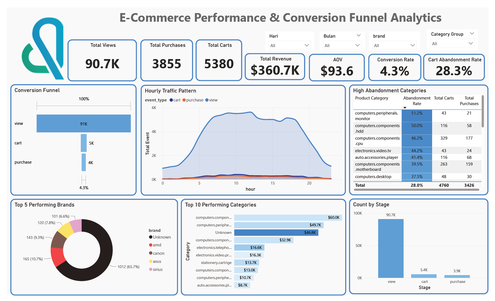

#  E-Commerce Funnel & Behavior Analysis

An end-to-end Business Intelligence project analyzing e-commerce user behavior, customer journey conversion funnels, and cart abandonment rates using Python (Google Colab), Power BI, and interactive dashboards.

---

## Project Overview
This repository contains a comprehensive data analytics and business intelligence solution designed to evaluate an online electronics store's performance. By examining user event logs, this project uncovers critical funnel drop-offs, hourly traffic patterns, and high-risk product categories to deliver actionable business recommendations.
---

##  Dashboard Preview

---

## Repository Structure
* **`Dashboard/`**: Contains the interactive Power BI dashboard files (.pbix / exports).
* **`Dataset/`**: Raw and cleaned datasets used for exploratory data analysis (sourced from Kaggle's *eCommerce events history in electronics store*).
* **`Slide/`**: Final presentation decks and executive summary slides (Canva/PDF).
* **`E-Commerce Funnel & Behavior Analysis.ipynb`**: The primary Google Colab notebook featuring data cleaning, exploratory analysis, and funnel computations.

---

## Key Findings & Metrics
* **Total Gross Revenue:** $360.7K
* **Average Order Value (AOV):** $93.6
* **Overall Conversion Rate (View to Purchase):** 4.3%
* **Major Funnel Leakage:** Only ~5.9% of total product views convert into added shopping carts.
* **Cart Abandonment Rate:** 28.3% overall, with high-ticket electronics (Monitors at 51.2%, HDDs at 50.0%, and CPUs at 46.2%) experiencing the highest drop-offs.
* **Peak Traffic Hours:** User engagement surges between 10:00 AM and 4:00 PM local time.

---

## Strategic Recommendations
1. **Product Detail Page (PDP) Optimization:** Implement scarcity badges, verified reviews, and clearer Call-to-Actions to bridge the View-to-Cart gap.
2. **Automated Remarketing:** Deploy targeted push notifications and reminder emails 2–4 hours post-abandonment for high-ticket items.
3. **Ad Spend Realignment:** Shift paid digital marketing budgets to coincide with peak traffic windows (9:00 AM – 2:00 PM) to maximize ROI.

---

## 👨‍💻 Author
* **Joko Santoso**
* *Data & BI Analyst*
* **Presentation Deck:** [View Canva Slide Presentation](https://canva.link/d53b8t2s6ltqk5p)
* Contact: santosoj160@gmail.com
